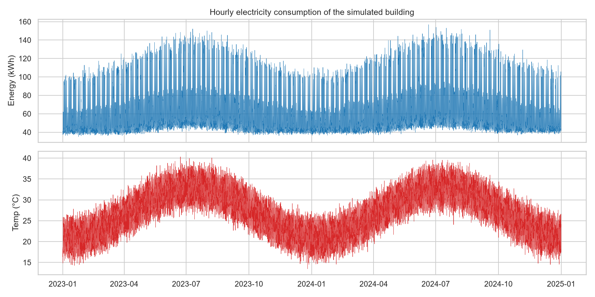
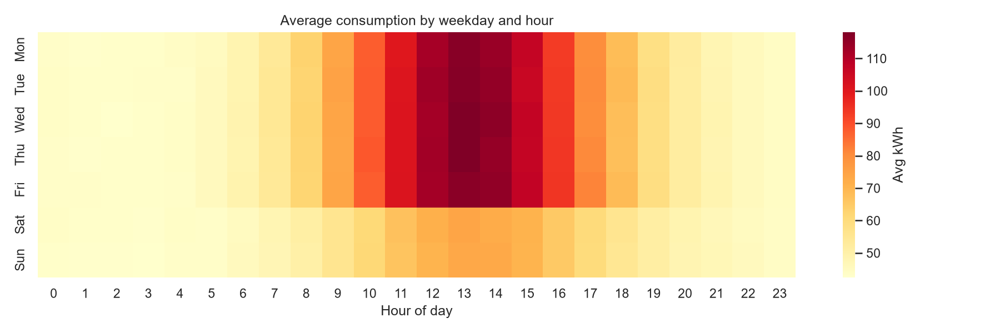
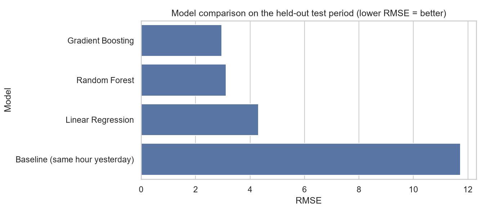
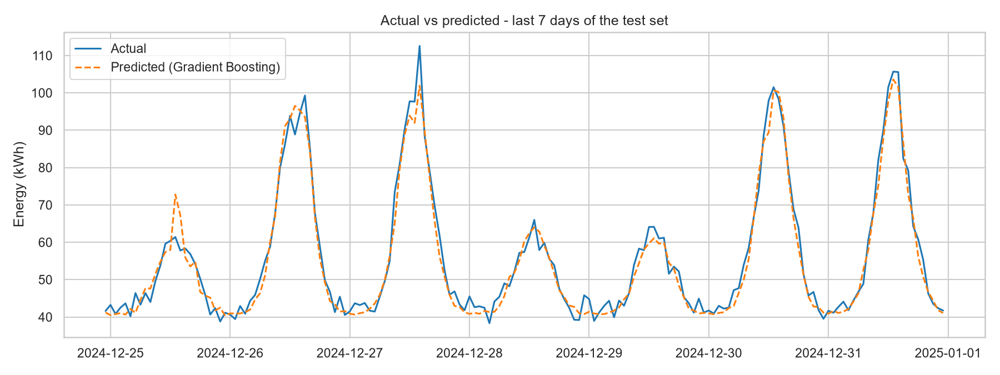
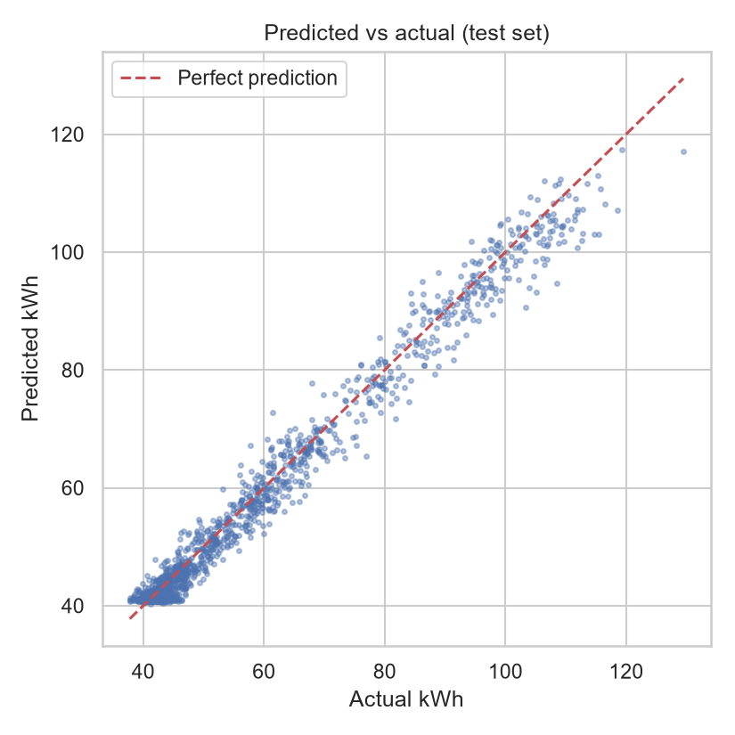
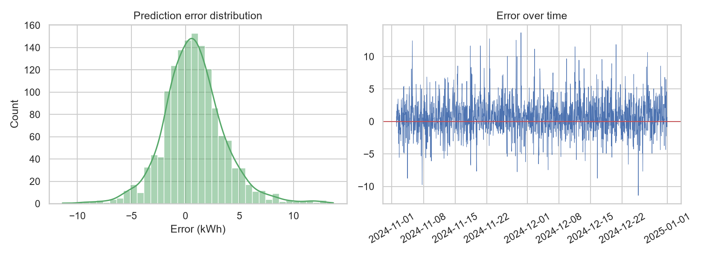
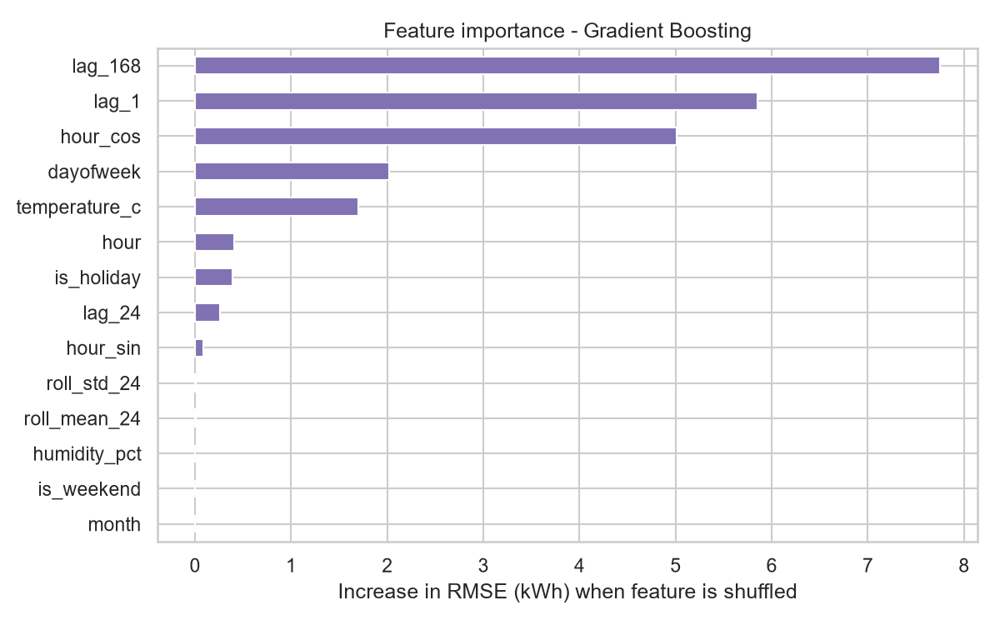
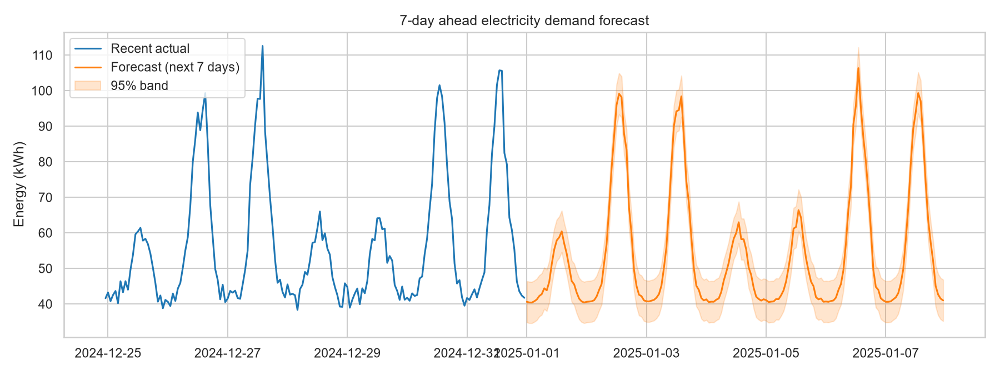

# ⚡ AI-Powered Energy Consumption Forecasting System

Forecast hourly electricity demand of a commercial building up to 7 days ahead using machine learning, and turn the forecast into a business insight (expected cost, peak day, peak hour).

> **Note on data:** no real utility data was available, so the project uses a **virtual simulation** of a smart meter (`src/generate_data.py`) that models occupancy, weather-driven air-conditioning, holidays, growth, noise, missing readings and sensor spikes. The pipeline is data-agnostic: replace `data/raw/building_energy.csv` with a real dataset that has the same columns and everything else works unchanged.

## 1. Problem Statement
Electricity cannot be stored cheaply, so utilities, factories, data centers and smart-city operators must know **how much power will be needed, and when**. Poor forecasts cause over-purchasing, peak-tariff penalties and grid stress. This project builds an end-to-end forecasting system that predicts hourly consumption and quantifies the cost impact.

## 2. Industry Relevance
| Sector | How forecasting is used |
|---|---|
| Electricity boards / DISCOMs | Day-ahead demand planning, power purchase, load balancing |
| Smart cities & buildings | HVAC scheduling, demand response, peak shaving |
| Manufacturing plants | Shift scheduling to avoid peak tariffs and demand charges |
| Data centers | Cooling and capacity planning |
| Renewable energy firms | Balance variable solar/wind supply with predicted demand |

## 3. Tech Stack
Python 3.10+, Pandas, NumPy, Scikit-learn (Linear Regression, Random Forest, Histogram Gradient Boosting), Matplotlib, Seaborn, Joblib. No GPU required.

## 4. Dataset
Two years of hourly data (17,544 rows, 2023-01-01 → 2024-12-31):

| Column | Description |
|---|---|
| `timestamp` | Hourly timestamp (index) |
| `temperature_c` | Outdoor temperature (°C) |
| `humidity_pct` | Relative humidity (%) |
| `is_holiday` | 1 on public holidays |
| `energy_kwh` | Building electricity consumption (target) |

About 1% of readings are deliberately missing and 0.2% are sensor spikes, so the cleaning step is realistic.

## 5. Architecture
```
 Simulated smart meter + weather
              │
              ▼
   data/raw/building_energy.csv
              │
              ▼
   preprocess.py ── fill gaps, remove spikes ──► data/processed/clean_energy.csv
              │
              ▼
   features.py ── calendar, sin/cos hour, lags (1h/24h/168h), rolling stats
              │
              ▼
   models.py ── chronological split (last 60 days = test)
              ├─ Baseline (same hour yesterday)
              ├─ Linear Regression
              ├─ Random Forest
              └─ Gradient Boosting ──► best model ──► models/best_model.joblib
              │
              ▼
   forecast.py ── recursive 7-day forecast + 95% band + business summary
              │
              ▼
   visualize.py ──► images/*.png        outputs/*.csv|json
```

## 6. Installation
```bash
git clone https://github.com/<your-username>/AI-Energy-Forecasting.git
cd AI-Energy-Forecasting
python -m venv venv
# Windows:  venv\Scripts\activate
# Mac/Linux: source venv/bin/activate
pip install -r requirements.txt
```

## 7. Usage
```bash
python main.py
```
This single command simulates the data (if missing), cleans it, builds features, trains and compares all models, saves the best one, draws every graph and produces the 7-day forecast. Runtime is about a minute on a laptop.

## 8. Results
Evaluated on a held-out final 60 days (never seen during training):

| Model | RMSE (kWh) | MAE (kWh) | MAPE | R² |
|---|---|---|---|---|
| **Gradient Boosting** | **2.96** | **2.19** | **3.7%** | **0.979** |
| Random Forest | 3.12 | 2.25 | 3.8% | 0.977 |
| Linear Regression | 4.31 | 3.29 | 5.8% | 0.956 |
| Baseline (same hour yesterday) | 11.72 | 6.61 | 10.3% | 0.672 |

The best model cuts error by about 75% versus the naive baseline.

**Sample business output (next 7 days):** ~9,191 kWh expected, estimated cost ₹67,556 under a two-tier tariff, peak day 2025-01-06, daily peak around 13:00 (ideal window to shift flexible loads away from).

## 9. Screenshots
| | |
|---|---|
|  |  |
|  |  |
|  |  |
|  |  |

## 10. Project Structure
```
AI-Energy-Forecasting/
├── data/            raw/ and processed/ datasets
├── notebooks/       exploration notebooks (optional)
├── src/             generate_data, preprocess, features, models, forecast, visualize
├── models/          saved trained model
├── outputs/         metrics.csv, forecast_next_7_days.csv, business_summary.json
├── images/          all generated graphs
├── docs/            GUIDE.md (full walkthrough)
├── main.py          runs the whole pipeline
├── requirements.txt
└── .gitignore
```

## 11. Learning Outcomes
- Time-series preprocessing: gap filling, outlier handling
- Feature engineering: lags, rolling windows, cyclical encoding, avoiding data leakage
- Correct time-series validation (chronological split, baseline comparison)
- Regression metrics: RMSE, MAE, MAPE, R²
- Recursive multi-step forecasting and uncertainty bands
- Translating predictions into business decisions
- Packaging a reproducible project on GitHub

## 12. Limitations & Future Work
- Data is simulated; validate on real datasets (e.g. UCI household power consumption, ASHRAE Great Energy Predictor III, or Indian smart-meter data)
- Future weather is simulated; connect a real weather forecast API
- Try ARIMA/SARIMA, Prophet, LSTM, and direct multi-horizon models
- Add a Streamlit dashboard and Dockerfile

## License
MIT
